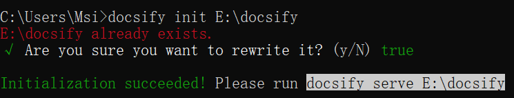

# Win10下Docsify部署及安装指南

## 检查Node.js版本

**使用 cmd 检查 nodejs 和 npm 的版本**

```bash
node -v
```

**nodejs 版本要大于 18.0.0**

```bash
npm -v
```

**npm 版本要大于 10.0.0**

> 我在安装的时候在初始化 docsify 的时候会出现找不到指令，我升级了 nodejs 和 npm 的版本之后，就 ok 了

## Node.js 安装配置

[nodejs 下载地址](https://nodejs.cn/download/)

## 本地安装运行docsify

**直接使用下面命令安装**

```bash
npm i docsify-cli -g
```

> 这里我也出现了问题，我嫌速度慢，使用了淘宝镜像，导致安装后依然不能初始化

> 下面是淘宝镜像

```bash
npm config set registry https://registry.npmmirror.com
```

**安装完成后初始化 docsify，创建一个默认模板**

```bash
docsify init D:/docsify
```

**创建完成后会提示你执行 docsify serve D:/docsify**



**运行创建的模板库**

```bash
docsify serve D:/docsify
```

## 修改样式

**html 模板文件（可以直接替换）**

```html
<!DOCTYPE html>
<html lang="en">

<head>
    <meta charset="UTF-8">
    <title>Docs</title>
    <meta http-equiv="X-UA-Compatible" content="IE=edge,chrome=1" />
    <meta name="description" content="Description">
    <meta name="viewport" content="width=device-width, user-scalable=no, initial-scale=1.0, maximum-scale=1.0, minimum-scale=1.0">
    <!-- 设置浏览器图标 -->
    <link rel="icon" href="/favicon.ico" type="image/x-icon" />
    <link rel="shortcut icon" href="/favicon.ico" type="image/x-icon" />
    <!-- 默认主题 -->
    <link rel="stylesheet" href="https://cdn.jsdelivr.net/npm/docsify@5/dist/themes/core.min.css">
</head>

<body>
    <!-- 定义加载时候的动作 -->
    <div id="app">...</div>
    <script>
        window.$docsify = {
            // 项目名称
            name: '',
            // 仓库地址，点击右上角的 Github 章鱼猫头像会跳转到此地址
            repo: 'https://github.com/Wang-YingGang',
            // 侧边栏支持，默认加载的是项目根目录下的 _sidebar.md 文件
            loadSidebar: true,
            // 导航栏支持，默认加载的是项目根目录下的 _navbar.md 文件
            loadNavbar: true,
            // 封面支持，默认加载的是项目根目录下的 _coverpage.md 文件
            coverpage: true,
            // 最大支持渲染的标题层级
            maxLevel: 5,
            // 自定义侧边栏后默认不会再生成目录，设置生成目录的最大层级（建议配置为 2-4）
            subMaxLevel: 2,
            // 小屏设备下合并导航栏到侧边栏
            mergeNavbar: true,
            /* 搜索相关设置 */
            search: {
                maxAge: 86400000, // 过期时间，单位毫秒，默认一天
                paths: 'auto', // 注意：仅适用于 paths: 'auto' 模式
                placeholder: '搜索',
                // 支持本地化
                placeholder: {
                    '/': '目录搜索',
                },
                noData: '找不到结果',
                depth: 4,
                hideOtherSidebarContent: true,
                namespace: 'Docs',
            }
        }
    </script>
    <!-- docsify 的 js 依赖 -->
    <script src="https://cdn.jsdelivr.net/npm/docsify@5/dist/docsify.min.js"></script>
    <!-- emoji 表情支持 -->
    <script src="https://cdn.jsdelivr.net/npm/docsify@5/dist/plugins/emoji.min.js"></script>
    <!-- 图片放大缩小支持 -->
    <script src="https://cdn.jsdelivr.net/npm/docsify@5/dist/plugins/zoom-image.min.js"></script>
    <!-- 搜索功能支持 -->
    <script src="https://cdn.jsdelivr.net/npm/docsify@5/dist/plugins/search.min.js"></script>
</body>

</html>
```

> 可以修改这里的参数改变样式

> 完整版本（带明暗主题和代码复制）见仓库里的 [index.html](https://github.com/Wang-YingGang/vangliee.github.io/blob/main/index.html)

**_coverpage.md（封面样式）**

> 内容如下：

```md
# 标题

[主页](/README.md)
```

> 通过修改 index.html 内的 coverpage=true 来开启，然后在根目录创建 _coverpage.md

**_sidebar.md（侧边栏样式）**

> 内容如下：

```md
* Other
  * [Win10下Docsify部署及安装指南](/docs/Other/Win10下Docsify部署及安装指南.md)
```

> 通过修改 index.html 内的 loadSidebar=true 来开启，然后在根目录创建 _sidebar.md

**_navbar.md（导航栏样式）**

> 内容如下：

```md
* 关于本人
  * [Github地址](https://github.com/Wang-YingGang)
```

> 通过修改 index.html 内的 loadNavbar=true 来开启，然后在根目录创建 _navbar.md

**修改完毕打开浏览器访问**

```text
http://localhost:3000/
```

> 完成！
